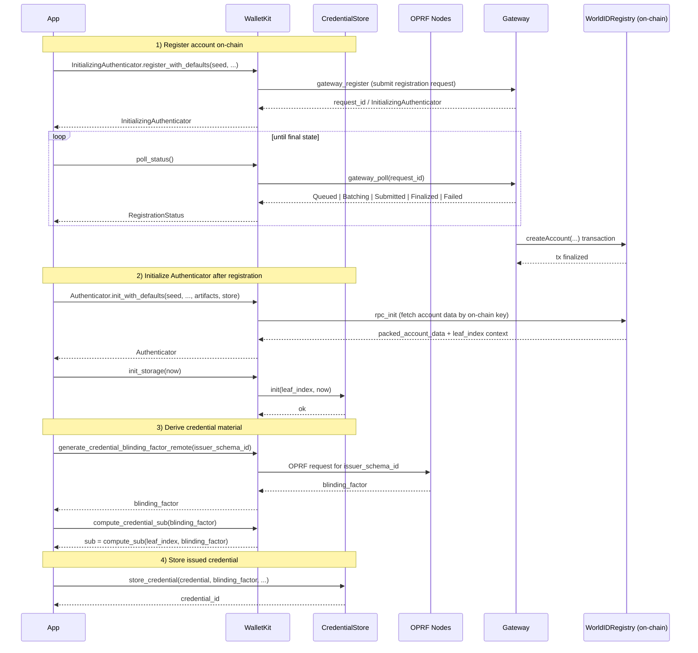

# Accounts and credentials

This page explains how a WalletKit app registers a World ID account, opens it, and
stores credentials for later proofs. Method names on this page are the Rust names;
the Swift, Kotlin, and browser APIs use the same names in their own casing.

## The authenticator seed

An account's authenticator keys derive from a 32-byte seed. The host app is
responsible for the seed:

- Generate it with a cryptographically secure random number generator.
- Store it securely and back it up. WalletKit doesn't persist the seed.
- Never expose it to third parties.

## The credential store

`CredentialStore` keeps the account's credentials in an encrypted SQLite vault.
On iOS and Android, the app creates it from platform components that hold the
database key in the device keystore; for the types involved, see the
[`storage` module on docs.rs](https://docs.rs/walletkit-core/latest/walletkit_core/storage/index.html).
In the browser, the app supplies the key itself; see
[Protect the database key](web/package.md#protect-the-database-key).

### Local blobs

The native `CredentialStore` API keeps plaintext PCP archives in the encrypted
vault with `put_blob`, `get_blob`, and `get_blob_by_legacy_path`. The outer device
seal must be removed before storing an archive and is never stored in the vault.
Backup-sealed inner members remain unchanged. The vault's encryption protects
the plaintext at rest.

`put_blob(kind, data, legacy_path, now)` computes and returns the 32-byte `BlobId`
using `blob_id(data)`: `SHA-256("worldid:credential-blob:v1" || data)`. Content
addressing is verified on every put. The owner supplies an opaque kind (such as `oxide.face`)
and optionally a legacy PCP path relative to its user data directory. Identical
data shares one row; each put updates its kind, preserves metadata and creation
time, and increments its revision. Reusing a legacy path moves that alias without
deleting the previous blob. Revisions are opaque counters, randomly seeded on creation
and incremented on each put or metadata write. Recreating identical data draws
a fresh 62-bit seed to reduce stale metadata CAS matches across deletion/recreation.

The `legacy_blob_paths` table maps legacy on-disk PCP paths only and will be
removed once those files are deleted. `get_blob_by_legacy_path` reads through
these aliases. `list_legacy_blob_paths` uses a literal, case-sensitive prefix;
an empty prefix lists all legacy paths and a trailing `/` selects a directory.
Legacy paths use `/`, normalize `.` and repeated separators, and reject absolute
paths, backslashes, drive prefixes, NULs and `..` components. `list_blobs` reads
metadata without loading blob data.
`update_blob_metadata` requires the revision read by the caller; a missing blob
or changed revision returns `StorageError::BlobRevisionConflict`.

These blobs and aliases are local-only. They are excluded from vault export,
merge and restore, do not schedule credential backups, and outlive credential
deletion. Owners manage retention with `delete_legacy_blob_path` (alias only) and
`delete_blob` (content and every alias). Removing a blob leaves credential links
intact.

## From registration to stored credential

The following diagram shows the calls between the app, WalletKit, and the World ID
services, from registration to a stored credential.

The steps in the diagram work as follows:

1. **Registration.** `InitializingAuthenticator::register_with_defaults` (or
   `register`) submits the account to the gateway. The app calls `poll_status`
   until the status is `Finalized` or `Failed`. A `Failed` status carries the
   gateway's `error` and, when available, an `error_code`.
1. **Authenticator creation.** After the account exists on-chain,
   `Authenticator::init_with_defaults` (or `init`) opens it. `init_storage(now)`
   then binds local storage to the account's leaf index.
1. **Blinding factor.** `generate_credential_blinding_factor_remote` asks the OPRF
   nodes for the blinding factor of an issuer schema.
1. **Credential subject.** `compute_credential_sub` derives the credential's `sub`
   locally from the account's leaf index and the blinding factor.
1. **Storage.** `store_credential` saves the issued credential with its blinding
   factor in the `CredentialStore`, so that later proofs can use both.
